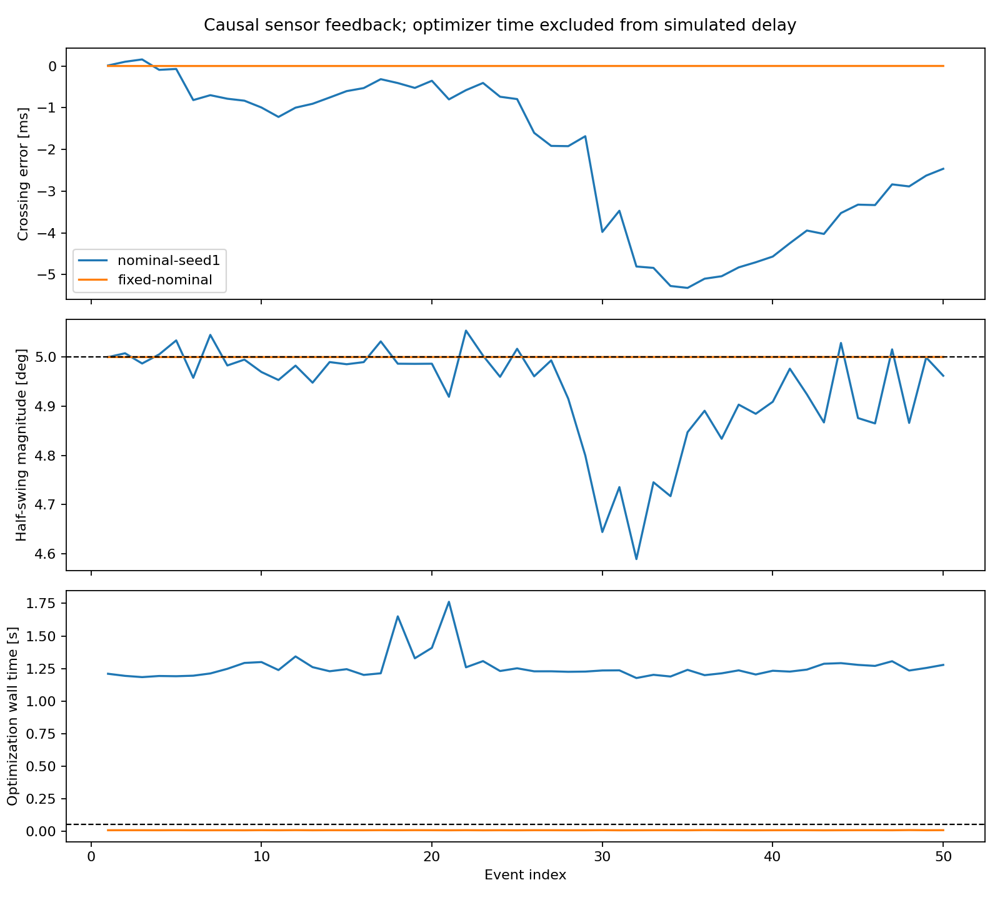
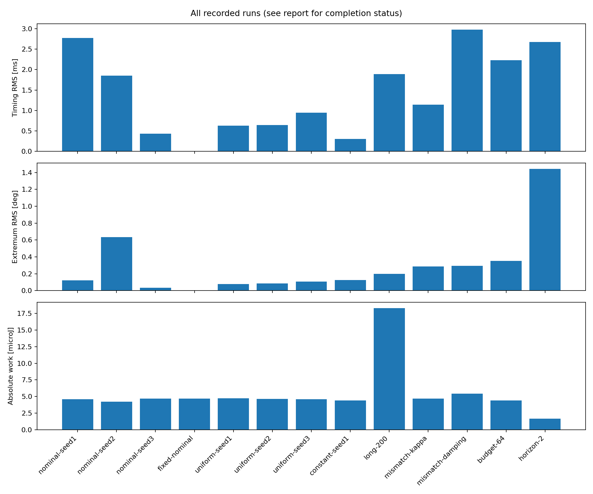
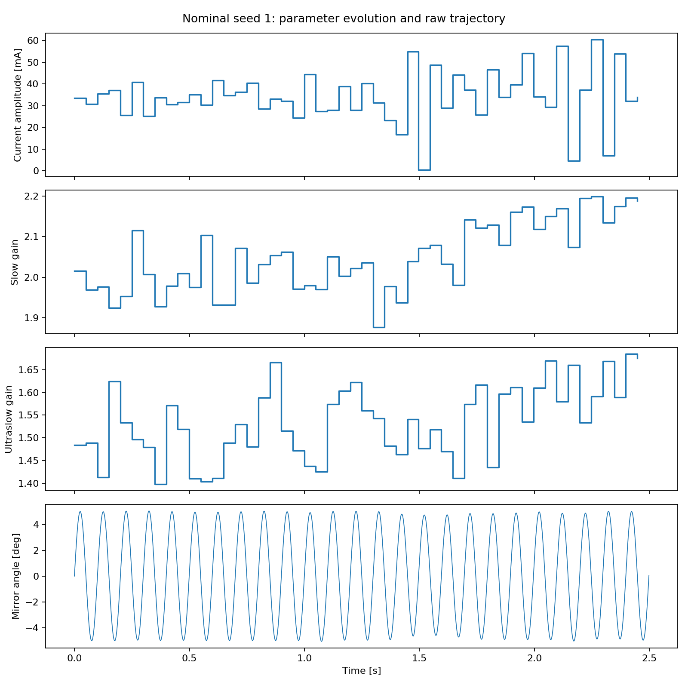
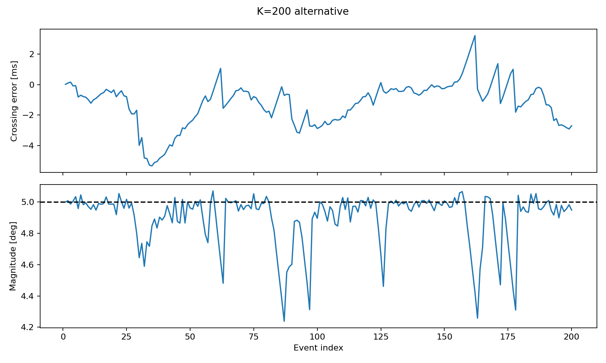
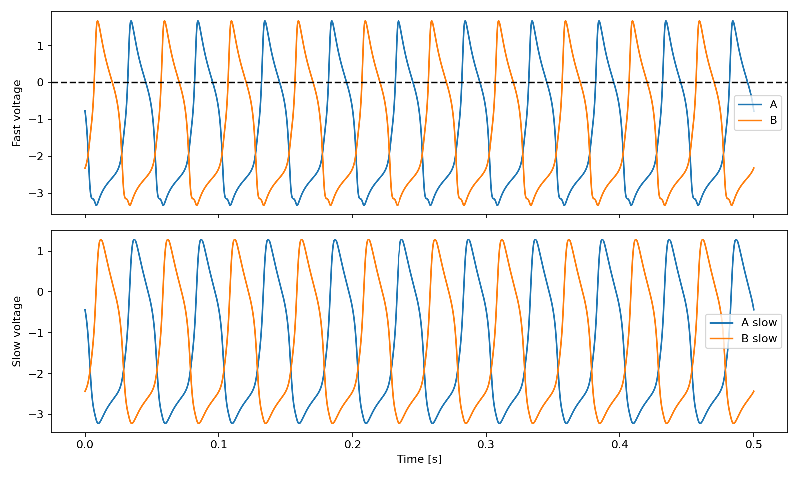
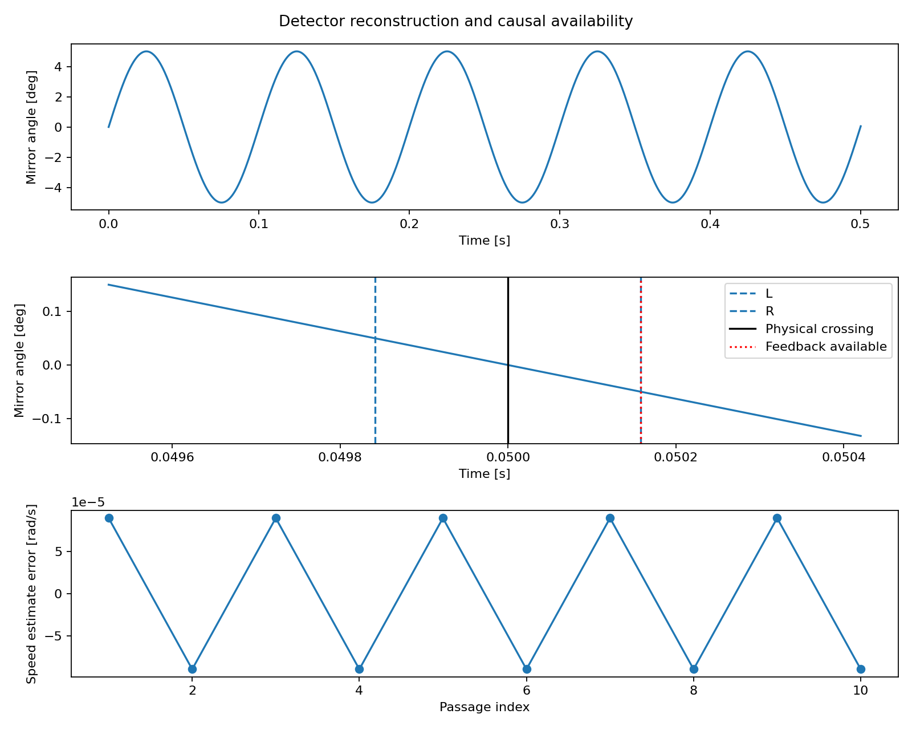
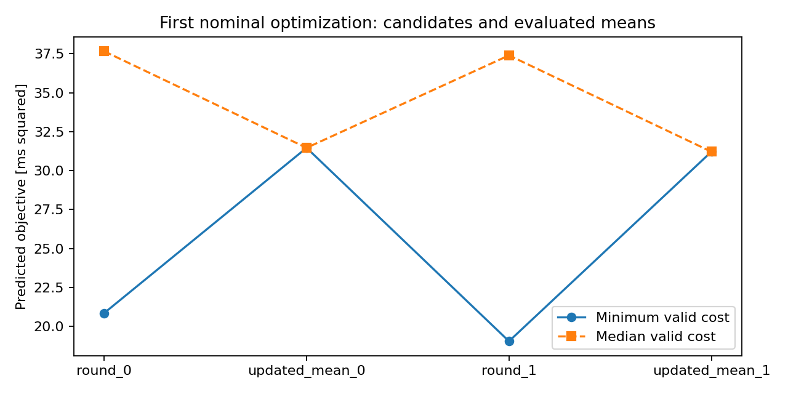

# Milestone F simulation results

Generated from saved raw data; no model integration occurs during reporting.
Settings and hypotheses: [experiment plan](../../docs/experiment-plan.md).

| Run | Status / intervals | Timing RMS (ms) | Extrema RMS (deg) | Abs. work (microJ) | Median / p95 optimization (s) | Invalid candidates |
|---|---|---:|---:|---:|---:|---:|
| nominal-seed1 | completed 50/50 | 2.7765 | 0.12293 | 4.6029 | 1.235 / 1.3789 | 0 |
| nominal-seed2 | completed 50/50 | 1.8478 | 0.63508 | 4.2113 | 1.2265 / 1.377 | 0 |
| nominal-seed3 | completed 50/50 | 0.43246 | 0.033063 | 4.6771 | 1.2287 / 1.292 | 0 |
| fixed-nominal | completed 50/50 | 0.00050569 | 0.00013162 | 4.6973 | 0.0061767 / 0.0067556 | 0 |
| uniform-seed1 | completed 50/50 | 0.62883 | 0.07832 | 4.7255 | 1.174 / 1.4419 | 0.0027626 |
| uniform-seed2 | completed 50/50 | 0.64165 | 0.08387 | 4.6607 | 1.1672 / 1.2246 | 0.0032685 |
| uniform-seed3 | completed 50/50 | 0.94737 | 0.10547 | 4.6181 | 1.17 / 1.2691 | 0.0029572 |
| constant-seed1 | completed 50/50 | 0.30066 | 0.12534 | 4.4253 | 1.1552 / 1.2429 | 0 |
| long-200 | completed 200/200 | 1.8864 | 0.19807 | 18.266 | 1.17 / 1.4359 | 0 |
| mismatch-kappa | completed 50/50 | 1.1434 | 0.28676 | 4.6905 | 1.2346 / 1.4492 | 0 |
| mismatch-damping | completed 50/50 | 2.973 | 0.29358 | 5.4286 | 1.2362 / 1.8666 | 0 |
| budget-64 | completed 50/50 | 2.2274 | 0.35348 | 4.416 | 0.32129 / 0.36393 | 0 |
| horizon-2 | completed 50/50 | 2.6748 | 1.4417 | 1.6977 | 0.60958 / 0.63502 | 0 |

## Numerical findings

Across 3 nominal seeds, mean timing RMS is 1.68559 ms and mean extremum RMS is 0.263692 deg. Fixed nominal parameters give 0.000505692 ms and 0.000131616 deg. The nominal initialization is already close to the desired periodic orbit; these comparisons do not demonstrate a tracking advantage for MPC.
Mean nominal MPC absolute work is 4.49709 microJ versus fixed 4.69732 microJ. This is a mechanical-work comparison, not electrical consumption.
nominal: 3/3 completed runs. Timing RMS mean/sample SD = 1.68559 / 1.1804 ms; extrema RMS = 0.263692 / 0.32476 deg.
uniform: 3/3 completed runs. Timing RMS mean/sample SD = 0.739283 / 0.18032 ms; extrema RMS = 0.0892191 / 0.014343 deg.
Across nonfixed recorded runs, p95 optimization/event-duration ratios range from 7.269 to 37.07. A ratio over one rules out one-event computation on this tested setup without further changes. Fixed-baseline timing includes one logged nominal forecast, not a search.
Frozen nominal seed1 selected sequences passed independent/refined solver checks: True. Across 50 one-step forecasts, maximum predicted-versus-plant crossing error is 1.73721e-08 s and extremum error 1.81562e-06 rad. These are much smaller than the reported control errors; the observed tracking behavior cannot be presented as solver convergence failure. See [audit](forecast-audit.json).

Recorded closed-loop failures: 0. Total fallbacks: 0. Unrun: 0.

## Interpretation and limits

These results use literal (13), including its missing terminal timing penalty, and causal sensor availability. Optimization execution time is measured but not injected into simulated actuation delay. Compute-time ratios above one violate a one-interval execution budget on this machine; no real-time claim is supported.
Three-seed summaries report descriptive sample variation, not statistical significance. Mismatch and sensitivity magnitudes are declared evaluation choices; they do not prove robustness beyond these tested cases. Fixed and optimized HCO results must be compared across timing, amplitude and energy together; lower energy alone need not mean better tracking.
All statuses are retained. Metrics for truncated runs describe only their completed prefix and must not be presented as full-horizon success. The final-ten metrics are a descriptive tail window, not a proven steady state. Printed equation (4) is unchanged; exact and printed energy residuals are separate fields.
All candidate costs/statuses, configurations, detector and action histories, raw trajectories, seeds and original source provenance remain in the run directories. Runtime varies by machine and includes optimization work after a separately recorded JIT warmup. Windows execution remains untested.

Unrun configurations: none.

## Figures

