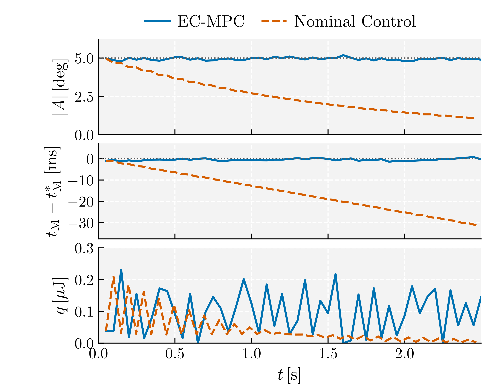
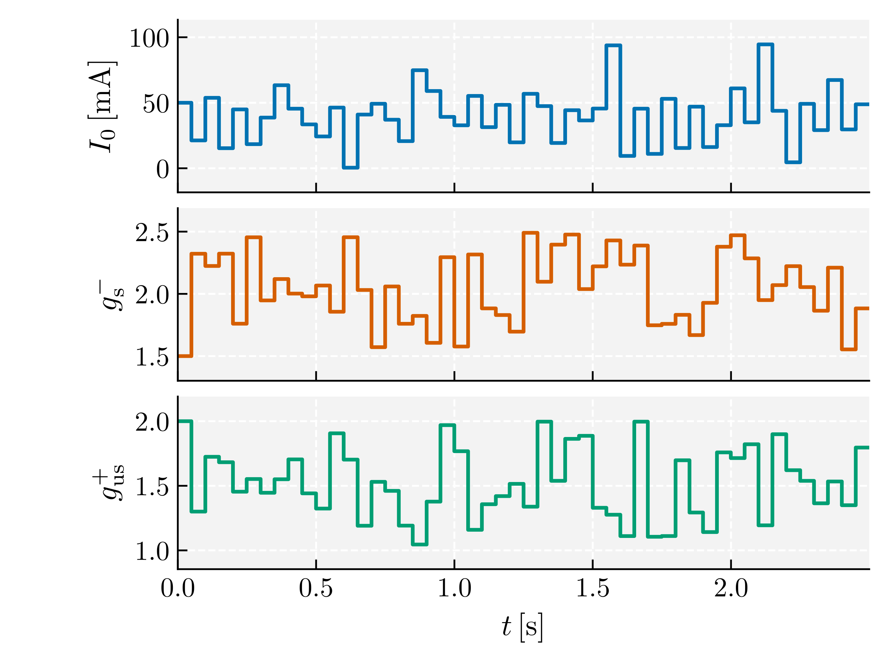
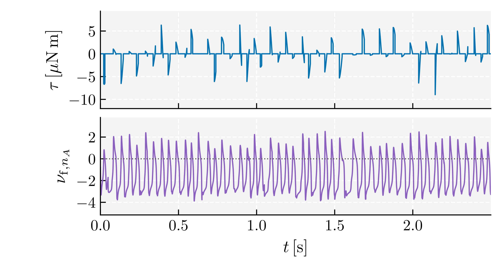

# 新参数比较：EC-MPC 与 Nominal Control

两个控制器从 I0=50mA、slow gain=1.5、ultraslow gain=2 开始。MPC 在首个
完整反馈后采用 uniform seed1 搜索；范围由用户改为 [1.5,2.5] × [1,2]。
两者均完成50个区间。详见[实验说明及复现命令](../../docs/startup-comparison.md)。

| 指标 | EC-MPC | Nominal Control |
|---|---:|---:|
| 幅值 RMS 误差 | 0.101715° | 2.698446° |
| 过零时间 RMS 误差 | 0.642633ms | 18.260071ms |
| 绝对机械能量交换 | 4.931174μJ | 2.004081μJ |

跟踪改善伴随更多机械作用，不能解读为电能下降。保留单个事先指定的 seed1，
没有筛选更有利的随机种子。优化计算时间没有加入模拟控制延迟。

图像均提供真正 LaTeX/Computer Modern 字体的 PDF、SVG 和600dpi PNG。
建议论文使用PDF。新版每个绘图区高:宽=1:4，间距约2mm，单位并入纵轴标签，
幅值标为 `|A| [deg]`。后两图的不同子图采用不同颜色，全部加入纵横网格。
整图默认宽4.5英寸，高度依次为3.575、3.315、2.36英寸；采用11pt坐标标签、
10pt刻度及11pt图例。可通过 `--width-inches` 调整宽度，维持绘图区的1:4比例。

图1：[PDF](figures/figure1-performance.pdf) · [SVG](figures/figure1-performance.svg)

图2：[PDF](figures/figure2-parameters.pdf) · [SVG](figures/figure2-parameters.svg)

图3：[PDF](figures/figure3-actuation.pdf) · [SVG](figures/figure3-actuation.svg)

`performance.csv` 为图1实际坐标。`rendering.json` 记录字体、尺寸、渲染模式及
指标；两个控制器子目录保留原始数据、动作和候选。`plan.json` 记录本次设置。
